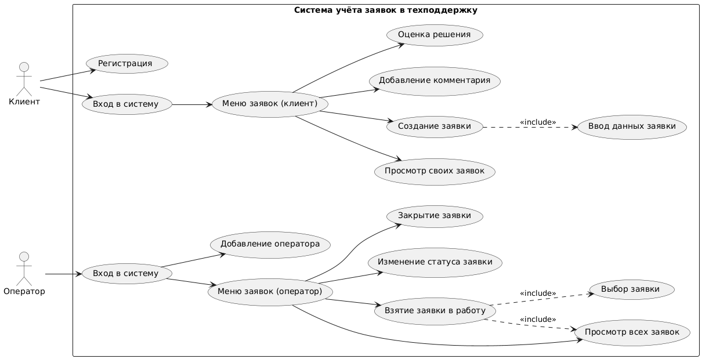
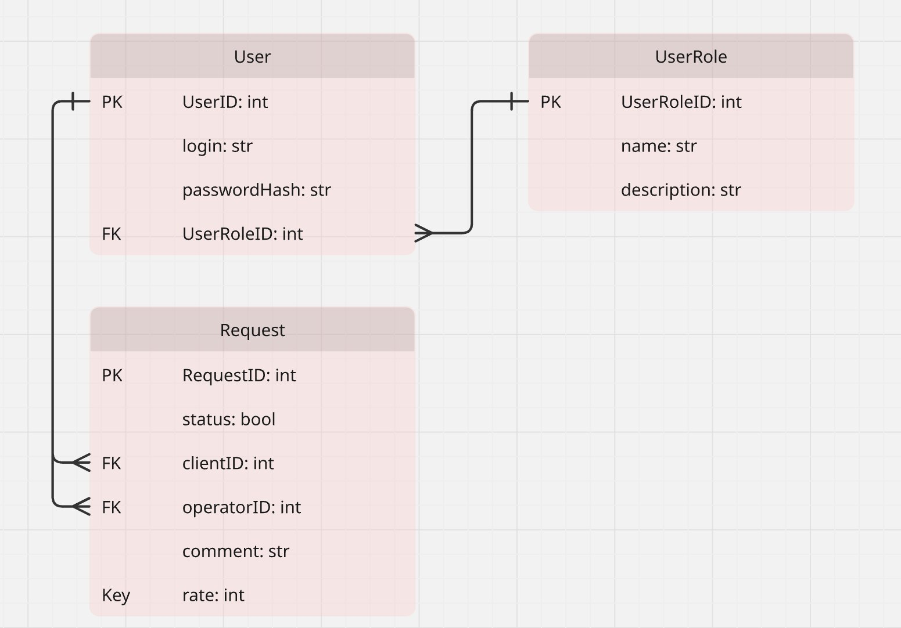

# Support Ticket Tracker

Учебный проект: система учёта заявок в техническую поддержку.
Разрабатывается пошагово в рамках лабораторных работ по дисциплине «Информатика».

## Содержание

- [Описание проекта](#описание-проекта)
- [Пользователи и роли](#пользователи-и-роли)
- [Основные функции](#основные-функции)
- [Архитектура](#архитектура)
- [Use Case диаграмма](#use-case-диаграмма)
- [ER-диаграмма базы данных](#er-диаграмма-базы-данных)
- [Структура репозитория](#структура-репозитория)
- [Сборка и запуск](#сборка-и-запуск)

## Описание проекта

Предметная область — приём, регистрация, обработка и закрытие заявок пользователей в службу технической поддержки организации. Система хранит описание проблемы, статус заявки, комментарии и оценку качества решения, которую оставляет клиент.

**Цели системы:**

- единый централизованный учёт всех заявок в техподдержку;
- сокращение времени реакции на обращения и решения проблем;
- прозрачность обработки заявки для клиента и контроль загрузки для оператора;
- сохранение истории обращений и решений.

## Пользователи и роли

| Роль | Возможности |
|---|---|
| **Клиент** | регистрация, создание заявки, просмотр своих заявок, добавление комментариев, оценка решения после закрытия |
| **Оператор** | просмотр всех заявок, взятие заявки в работу, комментарии, закрытие заявки, добавление новых операторов |

## Основные функции

1. Регистрация и вход в систему с разграничением ролей (клиент / оператор).
2. Создание заявки клиентом с описанием проблемы.
3. Просмотр заявок: клиент видит свои, оператор — все.
4. Взятие заявки в работу и её закрытие оператором.
5. Комментарии к заявке со стороны клиента и оператора.
6. Оценка клиентом решения по закрытой заявке (от 1 до 5).

## Архитектура

Приложение написано на Python и построено по классической многоуровневой архитектуре:

- **Presentation Layer** (`ui/`) — консольный интерфейс: меню, ввод и вывод данных, вход и регистрация;
- **Business Logic Layer** (`services/`) — бизнес-логика: проверка прав доступа, проверка данных, правила смены статуса заявки;
- **Data Layer** (`repositories/`, `models/`, `database/`) — модели данных (`dataclass`), репозитории с SQL-запросами и база данных SQLite.

Интерфейс обращается только к сервисам, сервисы — только к репозиториям, SQL-запросы находятся исключительно в репозиториях.

## Use Case диаграмма

Диаграмма построена в PlantUML, исходный файл — [`docs/diagrams/usecase.puml`](docs/diagrams/usecase.puml).



Два актёра — **Клиент** и **Оператор**. Создание заявки обязательно включает (`«include»`) ввод её данных, а взятие заявки в работу — просмотр списка всех заявок и выбор нужной.

## ER-диаграмма базы данных



База состоит из трёх таблиц: `UserRole` (справочник ролей), `User` (пользователи — клиенты и операторы) и `Request` (заявки). Связи — 1:N: одна роль у многих пользователей, один пользователь может иметь много заявок как клиент и вести много заявок как оператор.

## Структура репозитория

```
gitExample/
├── .git/                   # служебные данные Git
├── .gitignore
├── README.md
├── main.py                 # точка входа в программу
├── database/
│   ├── database.py         # подключение к SQLite, создание таблиц
│   └── schema.sql          # схема БД и тестовые данные
├── models/                 # модели данных (dataclass)
├── repositories/           # работа с БД, CRUD-операции
├── services/               # бизнес-логика
├── ui/                     # консольный интерфейс (меню, вход)
└── docs/
    └── diagrams/
        ├── usecase.puml    # исходник диаграммы (PlantUML)
        ├── usecase.png     # Use Case диаграмма
        └── er_diagram.png  # ER-диаграмма
```

## Сборка и запуск

Требуется Python 3.9 или новее. Сторонние библиотеки не нужны.

```
python main.py
```

База данных `database/tickets.db` создаётся автоматически при первом запуске из файла `schema.sql`. Чтобы вернуть базу к исходному состоянию, достаточно удалить файл `tickets.db` и запустить программу снова.

Тестовые пользователи:

| Роль | Логин | Пароль |
|---|---|---|
| Оператор | `operator1` | `oper123` |
| Клиент | `ivanov` | `1234` |
| Клиент | `petrova` | `1234` |